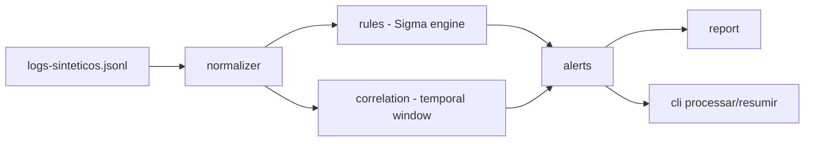

# siem-logs-lab

**English** · [Português (Brasil)](README.md)

[](#) [](#) [](#) [](#.github/workflows/ci.yml) [](LICENSE)

## What it is

A local **log-event detection lab** in the spirit of a SIEM: an engine that applies **Sigma-style rules** to a set of synthetic logs, does **temporal correlation** (a sliding window) and produces **alerts mapped to MITRE ATT&CK**. It ships with 7 configured detection rules.

## Status

An educational security lab, working and tested.

## Features

- **Sigma-style rule engine** (`regras.py`): parses conditions (selection, filter, condition) and evaluates events.
- **7 detection rules** in `dados/regras-sigma.yaml`:
  1. Multiple login failures from the same IP
  2. Successful login after failures
  3. Access outside the usual hours
  4. Privileged account used by a common user
  5. Abnormal download volume
  6. Connection to a blocked destination
  7. Resource enumeration
- **Temporal correlation** (`correlacao.py`): a sliding window anchored on the **most recently seen event** (not on the system clock), because a SIEM processes historical logs.
- **Event normalization** and **alert generation** (JSON), with a report.
- **CLI**: `processar` (logs → alert JSON) and `resumir` (alerts grouped by type).
- **MITRE ATT&CK**: a technique reference map in `dados/mitre-attack.yaml`.
- **Data simulation**: `gerar_logs.py` produces the synthetic dataset.

## Architecture

A `siemlab` package with separated modules: `normalizador` (standardizes events), `regras` (Sigma engine), `correlacao` (temporal window), `alertas` (generates/serializes), `relatorio` and `cli`. Declarative YAML config (rules and MITRE map); synthetic data in JSONL.



## Stack

- Python ≥ 3.10
- PyYAML ≥ 6.0 (the only runtime dependency)
- pytest + pytest-cov (dev)
- CI: GitHub Actions (windows-latest, Python 3.11)

## Repository layout

```
siem-logs-lab/
├── src/siemlab/
│   ├── normalizador.py    # standardizes events
│   ├── regras.py          # Sigma rule engine
│   ├── correlacao.py      # sliding temporal window
│   ├── alertas.py · relatorio.py
│   └── cli.py
├── dados/
│   ├── logs-sinteticos.jsonl   # 2,378 log events
│   ├── regras-sigma.yaml       # 7 rules
│   └── mitre-attack.yaml       # technique reference
├── docs/                    # how to write a Sigma rule, detection rules
├── exemplos/                # alertas.json, real output (pytest: 115 passed)
├── gerar_logs.py            # generates the synthetic data
├── .github/workflows/ci.yml
└── LICENSE                  # MIT
```

## Prerequisites and installation

Python ≥ 3.10.

```bash
python -m pip install -r requirements.txt
# for tests:
python -m pip install -e ".[dev]"
```

## How to run

```bash
# process logs and write alerts
python -m siemlab processar dados/logs-sinteticos.jsonl --regras dados/regras-sigma.yaml --saida alertas.json

# summarize alerts by type
python -m siemlab resumir dados/logs-sinteticos.jsonl --regras dados/regras-sigma.yaml

# (optional) regenerate the synthetic logs
python gerar_logs.py
```

## Tests and quality

Real command, verified by the agent:

```bash
python -m pytest tests/
```

Result: **115 tests passing** (6 test files). CI runs `pytest --cov=siemlab --cov-fail-under=70` on windows-latest (Python 3.11), plus `verificar_encoding.py`.

## Technical decisions and trade-offs

- **YAML Sigma-style rules instead of hardcoded code**: adding a rule does not require touching the engine.
- **Window anchored on the latest event, not on `now()`**: reprocessing historical logs needs context relative to the data, not to the system clock.
- **A single dependency (PyYAML)**: keeps the lab light and reproducible.

## Known limitations and roadmap

- 7 rules cover common detection cases, not a full SIEM.
- The data is synthetic (generated by `gerar_logs.py`).
- Correlation implements a simple temporal window; no advanced grouping heuristics.

## Development process

An individual project by Kelvin Oliveira, built with orchestrated AI agents and reviewed by the author. The rule engine, the correlation and the MITRE mapping are the author's.

## License and author

MIT — Copyright (c) 2026 Kelvin Rebelo de Oliveira.

**Author**: [Kelvin Oliveira](https://github.com/KelvinOliveiraCode) · [Portfolio](https://kelvinoliveiracode.github.io/portfolio/)
