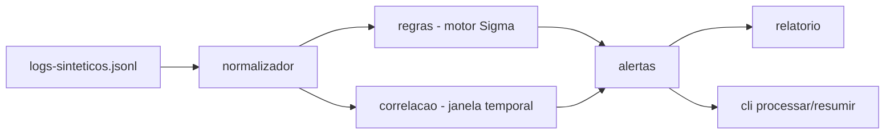

# siem-logs-lab

[English](README.en.md) · **Português (Brasil)**

[](#) [](#) [](#) [](#.github/workflows/ci.yml) [](LICENSE)

## O que é

Laboratório local de **detecção de eventos** em logs, no espírito de um SIEM: um motor que aplica **regras estilo Sigma** sobre um conjunto de logs sintéticos, faz **correlação temporal** (janela deslizante) e gera **alertas mapeados para MITRE ATT&CK**. Tem 7 regras de detecção configuradas.

## Status

Laboratório educacional de segurança, funcional e testado.

## Funcionalidades

- **Motor de regras estilo Sigma** (`regras.py`): parseia condições (seleção, filtro, condição) e avalia eventos.
- **7 regras de detecção** em `dados/regras-sigma.yaml`:
  1. Múltiplas falhas de login do mesmo IP
  2. Login bem-sucedido após falhas
  3. Acesso fora do horário habitual
  4. Conta de privilégio em uso por usuário comum
  5. Download de volume anormal
  6. Conexão para destino bloqueado
  7. Enumeração de recursos
- **Correlação temporal** (`correlacao.py`): janela deslizante ancorada no **evento mais recente visto** (não no relógio do sistema), porque o SIEM processa log histórico.
- **Normalização** de eventos e **geração de alertas** (JSON), com relatório.
- **CLI**: `processar` (logs → alertas JSON) e `resumir` (alerta agrupado por tipo).
- **MITRE ATT&CK**: mapa de técnicas de referência em `dados/mitre-attack.yaml`.
- **Simulação de dados**: `gerar_logs.py` produz o dataset sintético.

## Arquitetura

Pacote `siemlab` com módulos separados: `normalizador` (padroniza eventos), `regras` (motor Sigma), `correlacao` (janela temporal), `alertas` (gera/serializa), `relatorio` e `cli`. Configuração declarativa em YAML (regras e mapa MITRE); dados sintéticos em JSONL.



## Stack

- Python ≥ 3.10
- PyYAML ≥ 6.0 (única dependência de runtime)
- pytest + pytest-cov (dev)
- CI: GitHub Actions (windows-latest, Python 3.11)

## Estrutura do repositório

```
siem-logs-lab/
├── src/siemlab/
│   ├── normalizador.py    # padroniza eventos
│   ├── regras.py          # motor de regras Sigma
│   ├── correlacao.py      # janela temporal deslizante
│   ├── alertas.py · relatorio.py
│   └── cli.py
├── dados/
│   ├── logs-sinteticos.jsonl   # 2.378 eventos de log
│   ├── regras-sigma.yaml       # 7 regras
│   └── mitre-attack.yaml       # referência de técnicas
├── docs/                    # como escrever regra Sigma, regras de detecção
├── exemplos/                # alertas.json, saída real (pytest: 115 passed)
├── gerar_logs.py            # gera os dados sintéticos
├── .github/workflows/ci.yml
└── LICENSE                  # MIT
```

## Pré-requisitos e instalação

Python ≥ 3.10.

```bash
python -m pip install -r requirements.txt
# para testes:
python -m pip install -e ".[dev]"
```

## Como executar

```bash
# processa logs e grava alertas
python -m siemlab processar dados/logs-sinteticos.jsonl --regras dados/regras-sigma.yaml --saida alertas.json

# resume os alertas por tipo
python -m siemlab resumir dados/logs-sinteticos.jsonl --regras dados/regras-sigma.yaml

# (opcional) regenera os logs sintéticos
python gerar_logs.py
```

## Testes e qualidade

Comando real, verificado pelo agente:

```bash
python -m pytest tests/
```

Resultado: **115 testes passando** (6 arquivos de teste). CI roda `pytest --cov=siemlab --cov-fail-under=70` em windows-latest (Python 3.11), além de `verificar_encoding.py`.

## Decisões técnicas e trade-offs

- **Regras em YAML estilo Sigma em vez de código hardcoded**: adicionar uma regra não exige tocar no motor.
- **Janela ancorada no último evento, não em `now()`**: reprocessar um log histórico precisa de contexto relativo ao dado, não ao relógio do sistema.
- **Única dependência (PyYAML)**: mantém o laboratório leve e reproduzível.

## Limitações conhecidas e roadmap

- 7 regras cobrem casos comuns de detecção, não um SIEM completo.
- Dados são sintéticos (gerados por `gerar_logs.py`).
- Correlação implementa janela temporal simples; sem heurísticas de agrupamento mais avançadas.

## Processo de desenvolvimento

Projeto individual de Kelvin Oliveira, construído com agentes de IA orquestrados e revisado pelo autor. O motor de regras, a correlação e o mapeamento MITRE são do autor.

## Licença e autor

MIT — Copyright (c) 2026 Kelvin Rebelo de Oliveira.

**Autor**: [Kelvin Oliveira](https://github.com/KelvinOliveiraCode) · [Portfólio](https://kelvinoliveiracode.github.io/portfolio/)
